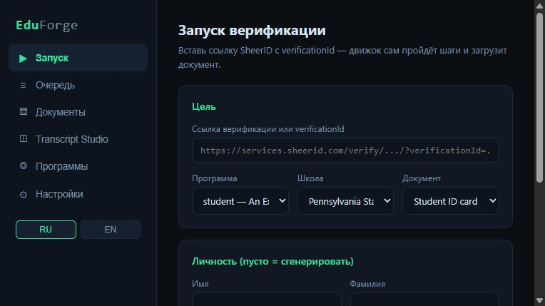
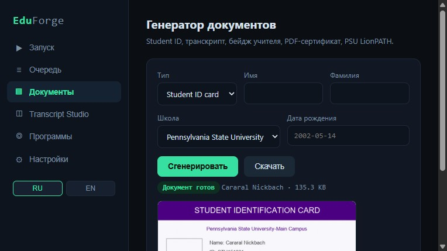
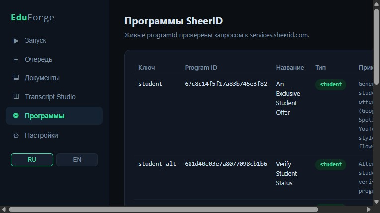
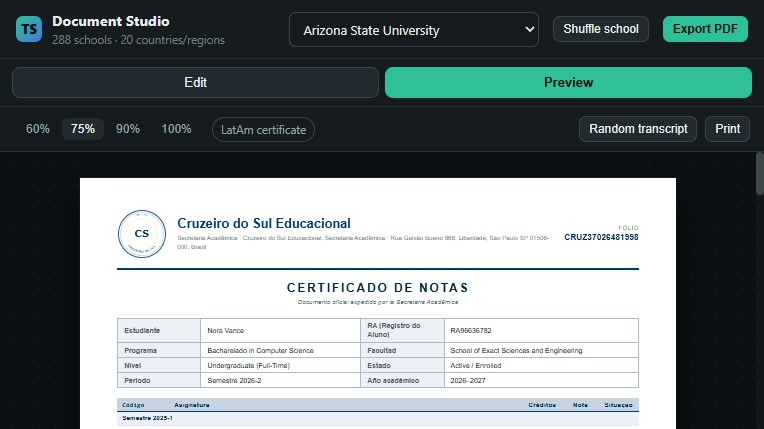

# EduForge

Комбайн для верификации студенческих/учительских офферов через SheerID: единый движок API-флоу, генераторы документов, очередь задач и веб-дашборд. Интерфейс RU/EN, без китайского.

**Гайд «что куда»:** [GUIDE.md](GUIDE.md) · **Офферы (что абузить):** [docs/OFFERS.md](docs/OFFERS.md) · **Скриншоты:** [docs/screenshots/](docs/screenshots/)

## Дашборд

| Запуск | Документы | Программы |
|--------|-----------|-----------|
|  |  |  |

Transcript Studio — 288 школ, рендер транскрипта в браузере:



## Возможности

- **Движок верификации** — полный флоу SheerID по API: отправка личной информации → пропуск SSO → запрос загрузки → PUT в S3 → completeDocUpload → опрос статуса. TLS-имперсонация (curl_cffi) + NewRelic-заголовки, ротация User-Agent, поддержка прокси.
- **Генераторы документов** — Student ID, транскрипт, бейдж учителя, PDF-сертификат учителя, PSU LionPATH-карта (Pillow / xhtml2pdf / Playwright).
- **Transcript Studio** — отдельный модуль: 288 школ, 8 макетов, 20 стран, 15 систем оценок, рендер в браузере и экспорт PDF (`/transcript/`).
- **Очередь задач** — асинхронная очередь с ограничением конкуренции, SQLite-история, автообновление статуса в дашборде.
- **Дашборд** — тёмная тема, RU/EN, разделы: Запуск / Очередь / Документы / Transcript Studio / Программы / Настройки.

## Программы (programId проверены живым запросом)

| Ключ | Program ID | Оффер |
|------|-----------|-------|
| student | 67c8c14f5f17a83b745e3f82 | An Exclusive Student Offer |
| student_alt | 681d40e03e7a8077098cb1b6 | Verify Student Status |
| student_br | 623e8edc19a65d5a7db2969a | Oferta exclusiva para estudantes (PT) |
| teachers | 68d47554aa292d20b9bec8f7 | Special Offer Just For Teachers |
| veterans | 690415d58971e73ca187d8c9 | Honoring All Who Served |
| generic | 5b0721a52094bf13b4024c5d | SheerID Verification |

Мёртвые (404): Bolt.new `68cc6a2e…`, Google One legacy `67c88d2e…`, Cursor student `681044b7…` (программа закрыта 25.06.2026).

## Установка

```bash
python -m venv .venv
.venv/Scripts/python -m pip install -r requirements.txt   # Windows
# .venv/bin/python -m pip install -r requirements.txt     # Linux
.venv/Scripts/python -m playwright install chromium       # для PNG-генераторов
```

## Запуск

```bash
python -m server.main
# http://127.0.0.1:8895
```

Переменные окружения:
- `EDUFORGE_PORT` — порт (по умолчанию 8895)
- `EDUFORGE_CONCURRENCY` — одновременных задач (по умолчанию 3)
- `EDUFORGE_TOKEN` — admin-токен; если задан, `/api/verify` и `/api/generate` требуют заголовок `X-Admin-Token`

## API

- `GET /health`
- `GET /api/programs` · `GET /api/schools` · `GET /api/doc_types`
- `POST /api/generate` `{doc_type, first, last, school_id, dob}` → файл документа
- `POST /api/verify` `{url|vid, program, school_id, doc_type, first, last, email, birth_date, proxy, skip_sso}` → `{task_id}`
- `GET /api/tasks` · `GET /api/task/{id}`
- `GET /api/status/{vid}` — живой статус заявки

## Как это работает

1. На стороне вендора (Google/Spotify/ChatGPT и т.д.) запускаешь верификацию — открывается виджет SheerID, в URL появляется `verificationId` (24 hex).
2. Копируешь ссылку в дашборд → выбираешь программу, школу и тип документа → «Запустить».
3. Движок генерирует документ, проходит шаги API и загружает файл. Статус заявки опрашивается через `my.sheerid.com/rest/v2/verification/{vid}`.

> Некоторые вендоры ставят собственный гейт ДО SheerID (например, ChatGPT for Teachers требует школьный email-домен). В таком случае заявка SheerID не создаётся и комбайн не поможет — нужен реальный домен.

## Docker

```bash
docker compose -f docker/docker-compose.yml up --build
```

## Структура

```
server/
  main.py            FastAPI-приложение
  config.py          программы, школы, эндпоинты
  gendocs.py         диспетчер генераторов + синтетическая личность
  storage.py         SQLite-очередь/история
  engine/
    client.py        SheerID API-флоу
    antidetect.py    TLS-имперсонация, NewRelic, UA-ротация, прокси
  generators/
    docgen.py        Student ID / транскрипт / бейдж (Pillow)
    teacher.py       PDF/PNG-сертификат учителя
    psu.py           PSU LionPATH-карта
    names.py         генератор имён/email/дат
web/
  index.html         дашборд (RU/EN)
  transcript/        Transcript Studio (288 школ)
```

## Лицензия

MIT